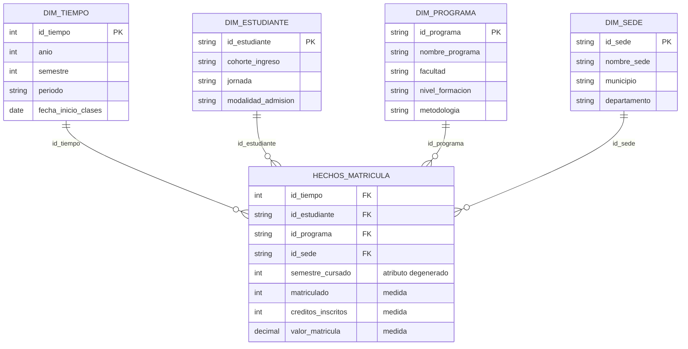

# Diseña un modelo estrella · Actividad calificable Corte 1

**Proceso de negocio: matrícula académica**
Juan José Horta Vanegas · Ingeniería de Sistemas · Inteligencia de Negocios · 2026-B

---

## 1. Proceso, pregunta de negocio y KPI

El proceso elegido es la **matrícula académica** en una institución de educación superior: el acto por el cual un estudiante formaliza su inscripción a un programa en un periodo determinado.

### La pregunta

> **¿En qué punto de la carrera estamos perdiendo estudiantes, y cómo se compara esa pérdida entre sedes y entre programas de la facultad?**

Es una pregunta que hoy se responde con impresiones. Se sabe que hay deserción y se habla de ella en términos generales, pero no es fácil ubicar el momento exacto en que ocurre, que es lo único que permite actuar: no es lo mismo perder estudiantes en primer semestre que en quinto, ni las causas ni las respuestas son las mismas.

### El KPI

**Retención de la cohorte a primer año.**

```
Retención a primer año (%) =
    (estudiantes de la cohorte matriculados en el tercer periodo académico
     ÷ estudiantes que ingresaron en esa cohorte) × 100
```

**Meta: ≥ 80%**, es decir, que de cada diez estudiantes que ingresan al menos ocho sigan un año después.

Formulé el indicador en positivo, como retención y no como deserción, porque es la forma en que las instituciones suelen fijarse metas y porque enunciar el objetivo en términos de lo que se quiere conservar orienta mejor la acción. El umbral del 80% es un punto de partida: lo correcto es calcular primero la línea base del programa y ajustarlo a partir de esa cifra, porque una meta muy por encima de lo que la institución logra hoy se incumpliría siempre y dejaría de servir como señal.

### La decisión que habilita

Si una cohorte cierra su primer año por debajo de la meta, **las horas de monitoría y tutoría del semestre siguiente se reasignan hacia las asignaturas donde se concentró la pérdida**, en lugar de repartirse de forma pareja entre todos los cursos como ocurre por defecto.

Ahí está el valor del indicador. No sirve para descubrir que existe deserción, eso ya se sabe. Sirve para decidir **dónde poner unos recursos de apoyo que son limitados**. Si el número cae, hay una acción concreta que ejecutar; si se mantiene sobre la meta, la asignación actual se conserva. Un indicador que no cambia ninguna conducta según el valor que tome no es un KPI: es una cifra en una diapositiva.

---

## 2. El sistema de origen es OLTP, y por qué el análisis no va ahí

### Clasificación

El sistema de origen es el **portal de matrícula académica**, la plataforma web donde los estudiantes inscriben materias y formalizan su matrícula cada semestre. Es un sistema **OLTP**, y lo es en todos los criterios:

| Criterio | Portal de matrícula |
|---|---|
| Propósito | Registrar la inscripción, completa y sin duplicados |
| Operación típica | Insertar y actualizar filas de a una |
| Datos | Estado actual del estudiante |
| Diseño | Normalizado, en muchas tablas |
| Usuario | Estudiantes y funcionarios de registro |
| Pregunta que responde | ¿Este estudiante quedó matriculado en este curso? |

Se nota especialmente en cómo se comporta bajo carga: en semana de matrículas recibe cientos de escrituras concurrentes, y lo único que se le exige es que no se caiga y no pierda ningún registro. Ninguno de sus requisitos de diseño tiene que ver con analizar.

### Por qué llevar los datos a un entorno OLAP

**Rendimiento.** Calcular la retención de cinco cohortes obliga a recorrer los registros de matrícula de cinco años, estudiante por estudiante y periodo por periodo. Mientras esa consulta corre, el portal tiene que seguir atendiendo a quien está inscribiendo materias en ese mismo instante. Es el escenario clásico donde un análisis pesado degrada la operación en vivo.

**Estructura.** La información de un solo estudiante está repartida entre las tablas de personas, inscripciones, cursos y periodos académicos. Esa división es correcta y deliberada, porque así se escribe sin duplicar datos, pero significa que cada consulta analítica debe unir cuatro o cinco tablas antes de empezar a contar. En un modelo dimensional, la misma pregunta se resuelve con una tabla de hechos y unas pocas dimensiones.

**Histórico.** Es el argumento decisivo en este caso. El portal mantiene el estado vigente porque es lo que necesita para operar, y no tiene ninguna razón funcional para conservar el detalle de cohortes antiguas. Pero la retención se define comparando un punto de partida con uno de llegada varios semestres después. Si ese histórico no se preserva íntegro, el indicador no resulta impreciso: simplemente no se puede calcular.

A esas tres se suma una cuarta razón propia de la pregunta planteada. Comparar entre sedes y entre programas exige **integrar** datos que en la operación viven separados, y el data warehouse es el único lugar donde conviven ya limpios y homogéneos.

---

## 3. Modelo estrella

### El grano

Antes de cualquier tabla hay que fijar qué representa una fila:

> **Una fila de HECHOS_MATRICULA es un estudiante, matriculado en un programa, en un periodo académico.**

La combinación `id_estudiante` + `id_tiempo` identifica cada fila de forma única. Elegí ese nivel porque la permanencia es una propiedad de una persona a lo largo del tiempo, así que la fila debe ser exactamente eso: una persona en un momento. Un grano más grueso —una fila por programa y periodo, con el total de matriculados— disolvería al estudiante dentro de un conteo, y sin el estudiante identificable no hay forma de saber si los matriculados de este semestre son los mismos del anterior. La retención dejaría de ser calculable y el error sería irreversible, porque desde un total nunca se recupera el detalle.

### Tabla de hechos: HECHOS_MATRICULA

| Campo | Rol | Justificación |
|---|---|---|
| `id_tiempo` | FK · clave | Conecta con DIM_TIEMPO. Junto con `id_estudiante` identifica la fila |
| `id_estudiante` | FK · clave | Conecta con DIM_ESTUDIANTE. Junto con `id_tiempo` identifica la fila |
| `id_programa` | FK | Conecta con DIM_PROGRAMA |
| `id_sede` | FK | Conecta con DIM_SEDE |
| `semestre_cursado` | Atributo degenerado | Numérico, pero sumarlo no significa nada. Vive aquí porque cambia en cada periodo y solo tiene sentido a este grano |
| `matriculado` | **Medida** | Contador que vale 1. Sumarlo da la población del periodo |
| `creditos_inscritos` | **Medida** | Créditos inscritos por el estudiante ese periodo. Aditivo |
| `valor_matricula` | **Medida** | Valor liquidado de la matrícula. Aditivo |

El criterio aplicado en cada campo es la prueba de la suma: si tiene sentido sumarlo es medida, si tiene sentido agrupar por él es atributo. `matriculado` puede parecer artificial, pero es el patrón estándar cuando lo que importa del hecho es la **ocurrencia** del evento y no una cantidad asociada a él; como el grano garantiza una fila por estudiante y periodo, ese conteo es directamente la población, sin necesidad de deduplicar.

Quedan fuera deliberadamente dos candidatos. El **promedio de créditos** no se guarda sino que se calcula, porque los promedios no son aditivos y el promedio de promedios no es el promedio real. Y un **total anual de matriculados** no aplica a este grano: mezclar granos en una misma tabla de hechos infla todas las sumas.

### DIM_TIEMPO

| Atributo | Ejemplo |
|---|---|
| `id_tiempo` (PK) | 20261 |
| `anio` | 2026 |
| `semestre` | 1 |
| `periodo` | 2026-1 |
| `fecha_inicio_clases` | 2026-01-26 |

Sin esta dimensión el modelo no serviría para nada de lo que se busca: la retención es por definición una comparación entre dos momentos. Es la dimensión que ordena los periodos y permite medir la distancia entre el ingreso de una cohorte y el punto donde se la vuelve a observar.

### DIM_ESTUDIANTE

| Atributo | Ejemplo |
|---|---|
| `id_estudiante` (PK) | E-00412 |
| `cohorte_ingreso` | 2025-1 |
| `jornada` | Diurna |
| `modalidad_admision` | Regular |

El atributo decisivo es `cohorte_ingreso`: se fija cuando el estudiante entra, no cambia nunca, y es lo que permite seguir a un grupo completo a lo largo del tiempo. Esa estabilidad es justamente lo que lo hace apto para una dimensión.

Por la razón contraria, `semestre_cursado` **no** está aquí. En una dimensión cada estudiante tiene una sola fila, mientras que el semestre que cursa cambia en cada periodo; guardado en la dimensión solo podría reflejar el último estado conocido y falsearía cualquier consulta histórica.

### DIM_PROGRAMA

| Atributo | Ejemplo |
|---|---|
| `id_programa` (PK) | P-07 |
| `nombre_programa` | Ingeniería de Sistemas |
| `facultad` | Ingeniería |
| `nivel_formacion` | Pregrado |
| `metodologia` | Presencial |

Permite comparar un programa contra los demás de la facultad sin modificar el modelo.

### DIM_SEDE

| Atributo | Ejemplo |
|---|---|
| `id_sede` (PK) | S-02 |
| `nombre_sede` | Prado Alto |
| `municipio` | Neiva |
| `departamento` | Huila |

La separé de DIM_ESTUDIANTE a propósito: la sede describe un lugar y no a la persona, y mantenerla aparte habilita la comparación geográfica sin repetir esos datos en cada estudiante.

Las cuatro dimensiones están **desnormalizadas**: la facultad vive dentro de Programa y el municipio dentro de Sede, sin subtablas. Es una estrella, no un copo de nieve, porque en BI la redundancia controlada se acepta a cambio de consultas más simples y rápidas.

---

## 4. El diagrama



Si el diagrama no se ve renderizado, esta es la misma estrella en texto:

```
                    ┌────────────────────┐
                    │     DIM_TIEMPO     │
                    │ anio, semestre,    │
                    │ periodo            │
                    └─────────┬──────────┘
                              │ id_tiempo
                              │
┌───────────────────┐   ┌─────┴──────────────┐   ┌────────────────────┐
│  DIM_ESTUDIANTE   │   │ HECHOS_MATRICULA   │   │    DIM_PROGRAMA    │
│ cohorte_ingreso,  ├───┤ id_tiempo          ├───┤ nombre_programa,   │
│ jornada,          │   │ id_estudiante      │   │ facultad, nivel    │
│ modalidad_admision│   │ id_programa        │   └────────────────────┘
└───────────────────┘   │ id_sede            │
                        │ semestre_cursado   │
                        │ matriculado    (▲) │    (▲) = medidas
                        │ creditos_insc. (▲) │
                        │ valor_matricula(▲) │
                        └─────────┬──────────┘
                                  │ id_sede
                        ┌─────────┴──────────┐
                        │      DIM_SEDE      │
                        │ nombre_sede,       │
                        │ municipio          │
                        └────────────────────┘
```

Cada dimensión está a un solo salto de la tabla de hechos.

---

## 5. Dos preguntas que el modelo responde

### Pregunta 1 · ¿Cuál fue la retención a primer año de cada cohorte de Ingeniería de Sistemas, comparada por sede?

Se cuentan los estudiantes distintos de una misma `cohorte_ingreso` en dos momentos: el periodo en que ingresaron y el tercer periodo académico posterior. La división entre ambos conteos da el porcentaje.

Todo lo necesario está en el modelo. `cohorte_ingreso` de DIM_ESTUDIANTE define el grupo a seguir, DIM_TIEMPO ordena los periodos y permite ubicar el punto de llegada, DIM_PROGRAMA filtra el programa y DIM_SEDE parte el resultado geográficamente. La medida es la suma de `matriculado`, con una sola unión por dimensión.

### Pregunta 2 · ¿Cómo evolucionó el número de matriculados por programa y jornada en los últimos cinco años?

Se suma `matriculado` agrupando por `anio` de DIM_TIEMPO, `nombre_programa` de DIM_PROGRAMA y `jornada` de DIM_ESTUDIANTE.

Lo relevante es que es una pregunta completamente distinta a la anterior y el modelo no cambia en nada: solo se agrupa por otros atributos. Esa es la flexibilidad que justifica diseñar bien las dimensiones desde el principio en lugar de construir una consulta a la medida de cada pregunta.

---

## Model & questions

The fact table of this model is `HECHOS_MATRICULA`, and its grain is one student enrolled in one program during one academic term, so each row is uniquely identified by the combination of `id_estudiante` and `id_tiempo`. It stores three additive measures: `matriculado`, a counter that always equals 1 and whose sum gives the enrolled population of a term; `creditos_inscritos`, the number of credits the student registered that term; and `valor_matricula`, the amount charged for that enrollment. The table also holds four foreign keys that connect it to the dimensions Tiempo, Estudiante, Programa and Sede, plus `semestre_cursado`, which is numeric but is not a measure, because adding semesters together produces no meaningful value.

The first business question the model answers is how first-year retention evolved for each cohort of the Systems Engineering program, broken down by campus. It is resolved by counting distinct students from the same `cohorte_ingreso` in their entry term and again in the third academic term, and then dividing one count by the other, using the Estudiante dimension to define the cohort, the Tiempo dimension to locate both moments, and the Sede dimension to split the result geographically.

The second question is how the number of enrolled students changed by program and study shift over the last five years, which is answered by summing the `matriculado` measure grouped by `anio`, `nombre_programa` and `jornada`. Both questions rely on exactly the same star schema without any structural change, which is the main advantage of dimensional modeling: a single well-designed model answers many different questions simply by changing the attributes used for grouping.
