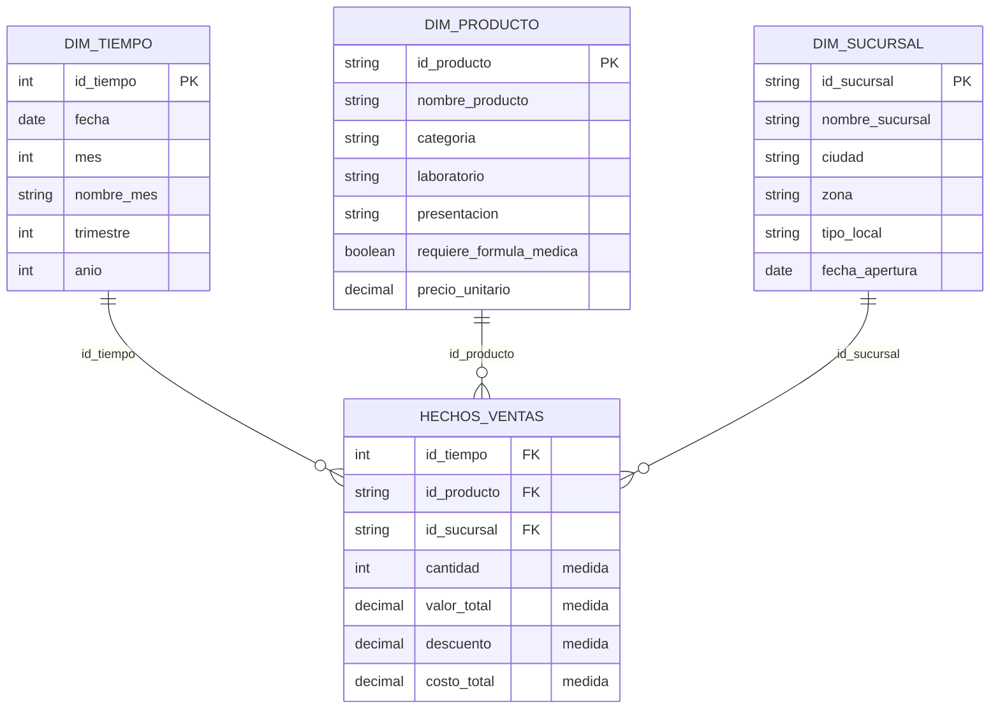

# Inteligencia de Negocios · Semana 5

**Preparación para el parcial del primer corte**
Juan José Horta Vanegas · Ingeniería de Sistemas · Unidad 1 · Corte 1 · 2026-B

---

## 1. Resumen del Corte 1

### Qué es BI y para qué sirve

La inteligencia de negocios transforma los datos de una organización en información accionable. La palabra que sostiene la definición es *accionable*: si un análisis no cambia lo que alguien va a hacer, no es BI, es un reporte.

### La cadena del dato

Lo que separa un peldaño del siguiente es el contexto que se le va agregando.

`ventas = 1200` es un **dato**: un hecho pelado que no dice nada. Cuando se le suma contexto —las ventas de la tienda norte cayeron a 1200 en julio, 30% menos que en junio— se vuelve **información**. Cuando eso deja de ser un caso aislado y se reconoce como patrón —cada vez que sube el costo de envío, esa zona vende menos— hay **conocimiento**. Y el último paso, el único que justifica todo lo anterior, es la **decisión**: absorber el envío en la zona norte durante agosto.

El salto difícil es el tercero. De dato a información llega cualquier herramienta; de información a conocimiento hace falta mirar varios periodos y cruzar variables.

### KPI

Un KPI es una métrica **atada a una meta**. Esa es toda la diferencia: "tuvimos 3.200 visitas" es una métrica, "conversión de visita a compra ≥ 4%" es un KPI.

Sin meta no hay forma de saber si el número está bien o mal, y si no se puede decir que está mal, tampoco se puede decidir nada. Prueba práctica: si no sabes qué harías distinto según el valor que tome, no es KPI.

**Los cuatro tipos de analítica** ordenan la ambición de las preguntas: descriptiva (*¿qué pasó?*), diagnóstica (*¿por qué pasó?*), predictiva (*¿qué pasará?*) y prescriptiva (*¿qué hacer?*). Este curso trabaja los dos primeros niveles.

### OLTP frente a OLAP

Son dos mundos con propósitos opuestos. **OLTP escribe, OLAP lee.**

Un sistema OLTP registra las operaciones del día a día —una venta, una matrícula— y está optimizado para escribir muchos datos pequeños, rápido y sin errores. Un sistema OLAP lee y agrega millones de filas históricas para responder preguntas de negocio. No hay uno mejor: hay uno adecuado para cada trabajo.

### Data warehouse

Es una base diseñada para analizar: reúne datos de varias fuentes operativas, ya limpios e integrados, y conserva el histórico organizado. No es una copia de respaldo, porque un respaldo replica la estructura original mientras el warehouse la **reorganiza**. El proceso que lo alimenta es el **ETL** (extraer, transformar, cargar).

Se analiza allí y no sobre producción por tres razones:

- **Rendimiento:** una consulta analítica pesada puede frenar el sistema que está operando en vivo.
- **Estructura:** la base OLTP está normalizada, lo que es excelente para escribir y pésimo para consultar.
- **Histórico:** los sistemas operativos sobrescriben o descartan el detalle antiguo, que es justo del que vive el análisis.

### Modelo estrella

Una **tabla de hechos** central, con los eventos medibles y sus **medidas** numéricas, rodeada de **tablas de dimensión** que guardan el contexto en forma de **atributos** descriptivos.

La regla para ubicar cualquier campo cabe en una línea: si tiene sentido **sumarlo**, es medida y va en hechos; si tiene sentido **agrupar por** ello, es atributo y va en una dimensión.

Funciona porque cada dimensión está a un solo salto de los hechos, porque las dimensiones se llaman como las llama la gente del negocio, y porque una misma estrella responde muchas preguntas cambiando solo por qué atributo se agrupa. Si cada dimensión se parte en subtablas se convierte en un **copo de nieve**, que gana normalización y pierde claridad.

---

## 2. Caso: cadena de farmacias

> *Una cadena de farmacias quiere analizar sus ventas por producto, sucursal y mes.*

### El grano

Cada fila de la tabla de hechos representa **una línea de venta**: un producto vendido, en una transacción, en una sucursal, en una fecha. Es el nivel más detallado del proceso, y conviene fijarlo ahí porque desde el detalle siempre se puede agregar hacia arriba, mientras que al revés no.

### Cómo salieron las dimensiones

De la propia pregunta. Las palabras que van después del "por" son las dimensiones: **producto**, **sucursal** y **mes** (que es Tiempo). Las tres están en el enunciado y una de ellas es Tiempo, así que el requisito de incluirla se cumple sin forzar nada.

### HECHOS_VENTAS

| Campo | Rol | Por qué |
|---|---|---|
| `id_tiempo` | FK | Conecta con DIM_TIEMPO |
| `id_producto` | FK | Conecta con DIM_PRODUCTO |
| `id_sucursal` | FK | Conecta con DIM_SUCURSAL |
| `cantidad` | Medida | Sumar unidades vendidas tiene sentido |
| `valor_total` | Medida | Es la venta de la línea; se suma por producto, sucursal o mes |
| `descuento` | Medida | Se suma para saber cuánto se dejó de cobrar |
| `costo_total` | Medida | Se suma, y restado del valor da el margen |

### Dos campos que NO van en los hechos

Aquí está el punto delicado del caso, porque los dos son numéricos y por eso engañan.

`precio_unitario` no se suma: sumar los precios de cien productos distintos no produce ninguna cifra interpretable. Describe al producto, así que es un atributo de DIM_PRODUCTO. Si se necesita el precio efectivo de una venta, se calcula dividiendo `valor_total` entre `cantidad`.

`stock_disponible` sí es un número que se suma, pero **no pertenece a este hecho**. El grano aquí es la venta, y el stock no es una propiedad de una venta sino del inventario en un momento dado. Es otro proceso de negocio y le corresponde su propia tabla de hechos, con su propio grano. Mezclarlos haría que el stock se duplicara en cada línea de venta del mismo producto.

### Las dimensiones

**DIM_TIEMPO** — `id_tiempo` (PK), `fecha`, `mes`, `nombre_mes`, `trimestre`, `anio`.
El enunciado pide análisis por mes, pero la dimensión se construye al nivel de fecha y de ahí se derivan mes, trimestre y año. Guardar solo el mes cerraría la puerta a cualquier análisis más fino sin ganar nada.

**DIM_PRODUCTO** — `id_producto` (PK), `nombre_producto`, `categoria`, `laboratorio`, `presentacion`, `requiere_formula_medica`, `precio_unitario`.
La categoría permite el agrupamiento más habitual del negocio, y `requiere_formula_medica` es un atributo propio del sector que abre una lectura interesante: cuánto del ingreso viene de venta libre y cuánto de medicamento formulado.

**DIM_SUCURSAL** — `id_sucursal` (PK), `nombre_sucursal`, `ciudad`, `zona`, `tipo_local`, `fecha_apertura`.
`fecha_apertura` sirve para no comparar de forma injusta una sucursal recién abierta con una de diez años.

### El diagrama



Si el diagrama no se ve renderizado:

```
                  ┌────────────────────┐
                  │     DIM_TIEMPO     │
                  │ fecha, mes,        │
                  │ trimestre, anio    │
                  └─────────┬──────────┘
                            │ id_tiempo
                            │
┌──────────────────┐  ┌─────┴──────────────┐  ┌────────────────────┐
│   DIM_PRODUCTO   │  │   HECHOS_VENTAS    │  │    DIM_SUCURSAL    │
│ nombre, categoria├──┤ id_tiempo          ├──┤ nombre, ciudad,    │
│ laboratorio,     │  │ id_producto        │  │ zona, tipo_local   │
│ precio_unitario  │  │ id_sucursal        │  └────────────────────┘
└──────────────────┘  │ cantidad       (▲) │
                      │ valor_total    (▲) │   (▲) = medidas
                      │ descuento      (▲) │
                      │ costo_total    (▲) │
                      └────────────────────┘
```

### Cómo responde la pregunta del enunciado

"Ventas por producto" es sumar `valor_total` agrupando por `nombre_producto` o por `categoria`. "Ventas por sucursal" cambia el agrupamiento a DIM_SUCURSAL. "Ventas por mes" lo cambia a DIM_TIEMPO. Es el mismo modelo, la misma medida y una sola unión en cada caso: no hay que rediseñar nada para pasar de una pregunta a otra.

---

## 3. Autodiagnóstico

### Lo que manejo bien

El modelado estrella es la parte que tengo más firme. La distinción entre medida y atributo la resuelvo con la prueba de la suma sin dudar, incluso cuando el campo es numérico y parece medida —el `precio_unitario` de este mismo caso—, y armar la estructura completa a partir de la pregunta de negocio me sale natural desde el ejercicio de matrículas de la semana 4. También tengo claro el grano, que es lo que más ordena el resto del diseño.

### Lo que debo repasar

**La cadena del dato y el KPI.** Distingo los cuatro peldaños cuando los veo escritos, pero al explicarlos me cuesta sostener la diferencia entre información y conocimiento sin recurrir siempre al mismo ejemplo. Me pasa algo parecido con el KPI: identifico si algo lo es o no, pero no siempre argumento bien *por qué* la meta es lo que lo convierte en indicador.

**OLTP contra OLAP y el data warehouse.** La regla de que uno escribe y el otro lee la tengo, y también las tres razones para no analizar sobre producción. Lo que me falla es aterrizarlas: puedo enumerar rendimiento, estructura e histórico, pero al explicar cada una con un ejemplo concreto me enredo, sobre todo con la de estructura.

### Una observación honesta sobre mi preparación

Resolví el simulacro y me fue bien, pero eso no me deja tranquilo: reconocer la respuesta correcta entre cuatro opciones es mucho más fácil que redactarla desde cero. El parcial tiene preguntas de explicación breve y una parte aplicada donde hay que justificar, así que el formato en el que me siento cómodo no es el formato en el que me van a evaluar.

### Plan antes del parcial

Voy a escribir de memoria, sin apuntes, las definiciones de dato, información, conocimiento, decisión y KPI, cada una con un ejemplo propio distinto al del material. Después haré lo mismo con las tres razones del data warehouse, obligándome a dar un ejemplo concreto de cada una. El modelado lo dejo en repaso ligero, resolviendo un caso rápido de un proceso que no haya trabajado antes para no acomodarme al de matrículas.
