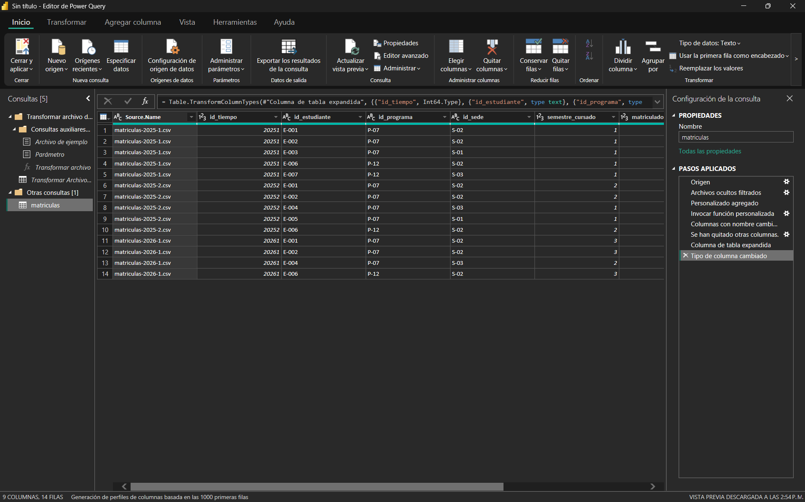

# Inteligencia de Negocios · Semana 7

**Conecta y combina fuentes con Power Query**
Juan José Horta Vanegas · Ingeniería de Sistemas · Unidad 2 · Corte 2 · 2026-B

---

## Las fuentes

Partí la tabla de hechos que construí en la semana 6 en tres archivos CSV, uno por periodo académico. Con eso reproduzco el escenario real del proceso: una institución no entrega un archivo único con todo el histórico, entrega un corte por semestre, y cada semestre llega uno nuevo.

Los tres archivos están en la carpeta `fuentes/`.

| Archivo | Periodo | Filas de datos | Formato |
|---|---|---|---|
| `matriculas-2025-1.csv` | 2025-1 | 5 | CSV, UTF-8, separador coma |
| `matriculas-2025-2.csv` | 2025-2 | 5 | CSV, UTF-8, separador coma |
| `matriculas-2026-1.csv` | 2026-1 | 4 | CSV, UTF-8, separador coma |

**Estructura común a los tres** (mismos encabezados, mismo orden, misma escritura):

```
id_tiempo, id_estudiante, id_programa, id_sede,
semestre_cursado, matriculado, creditos_inscritos, valor_matricula
```

Esa identidad de estructura no es un detalle menor: es la condición que hace posible la combinación. Si un archivo trajera una columna adicional o un encabezado escrito distinto, Power Query no podría apilarlos y quedarían columnas sueltas o vacías.

### Un detalle sobre el separador

Verifiqué que los archivos usen coma como separador y codificación UTF-8, porque son los dos puntos donde una conexión a CSV suele fallar. Excel en español exporta con punto y coma, ya que la coma está reservada como separador decimal, así que conectar asumiendo el separador equivocado deja todas las columnas pegadas en una sola. La ventana de conexión de Power BI permite elegir ambos parámetros y muestra una vista previa antes de importar: ahí es donde se detecta el problema, no después.

---

## El procedimiento

**1. Conexión.** Power BI Desktop → *Inicio* → *Obtener datos* → *Carpeta*, apuntando a `fuentes/`. Deliberadamente no conecté los tres archivos uno por uno. Conectar a la carpeta es lo que hace que la consulta apunte a un contenedor y no a tres rutas fijas, y es la única forma de que un archivo futuro entre sin tocar nada.

**2. Combinación.** Power Query lista los tres archivos y con *Combinar y transformar datos* los apila en una sola tabla. En ese momento genera automáticamente una consulta auxiliar y una función de transformación, que son las que aplican el mismo tratamiento a cada archivo del lote.

**3. Limpieza.** La tabla resultante no queda lista de entrada: la combinación agrega columnas administrativas propias del sistema de archivos —fecha de creación, fecha de modificación, ruta de acceso, atributos—. Las quité todas, salvo una.

Conservé **`Source.Name`**, la columna con el nombre del archivo de origen. Aquí sirve como trazabilidad: permite saber de qué corte salió cada fila y verificar que la combinación trajo los tres archivos completos. En este caso el periodo también viaja dentro del archivo en `id_tiempo`, así que la columna es redundante para el análisis; si no fuera así —si el periodo solo estuviera en el nombre del archivo— esa columna sería el único lugar donde vive ese dato y borrarla sería perderlo.

**4. Tipos de datos.** Verifiqué que los campos numéricos queden como número entero y no como texto, porque de eso depende que las medidas se puedan sumar más adelante.

El resultado son **14 filas** en una sola tabla, que es exactamente la suma de los tres archivos.

---

## Pasos aplicados



La receta quedó registrada en ese panel, y ahí está el valor real de hacer esto en Power Query en lugar de a mano. Lo que se guarda no es la tabla combinada sino el **procedimiento** que la produce, paso por paso y en orden. Cada paso se puede revisar, editar o eliminar, y la secuencia completa se vuelve a ejecutar cada vez que se actualiza.

---

## Cómo entra un archivo nuevo sin rehacer el trabajo

Cuando termine el periodo 2026-2 y llegue `matriculas-2026-2.csv`, el trabajo consiste en copiar ese archivo dentro de la carpeta `fuentes/` y pulsar **Actualizar** en Power BI. Nada más.

Funciona porque la consulta no apunta a tres archivos concretos sino a la **carpeta**. Al actualizar, Power Query vuelve a leer el contenido actual de esa ubicación, encuentra cuatro archivos donde antes había tres, aplica al nuevo exactamente la misma función de transformación que ya usa con los demás y reejecuta toda la secuencia de pasos sobre el conjunto completo. La tabla pasa de 14 a 19 filas sin que nadie haya tocado la consulta.

Esa es la diferencia entre guardar un resultado y guardar una receta. Si esto se hubiera hecho copiando y pegando en Excel, cada semestre habría que repetir el proceso entero a mano, con el riesgo de olvidar un paso o pegar un rango corrido. Aquí el costo de incorporar un periodo nuevo es arrastrar un archivo y hacer un clic, y el procedimiento es idéntico al del semestre pasado porque literalmente es el mismo.

La única condición es que el archivo nuevo mantenga la estructura de los anteriores. Si llegara con una columna distinta o con los encabezados cambiados, la combinación fallaría y habría que ajustar la consulta.
