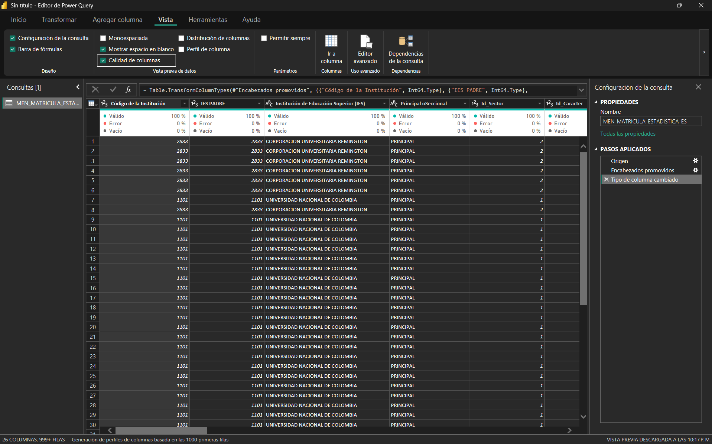
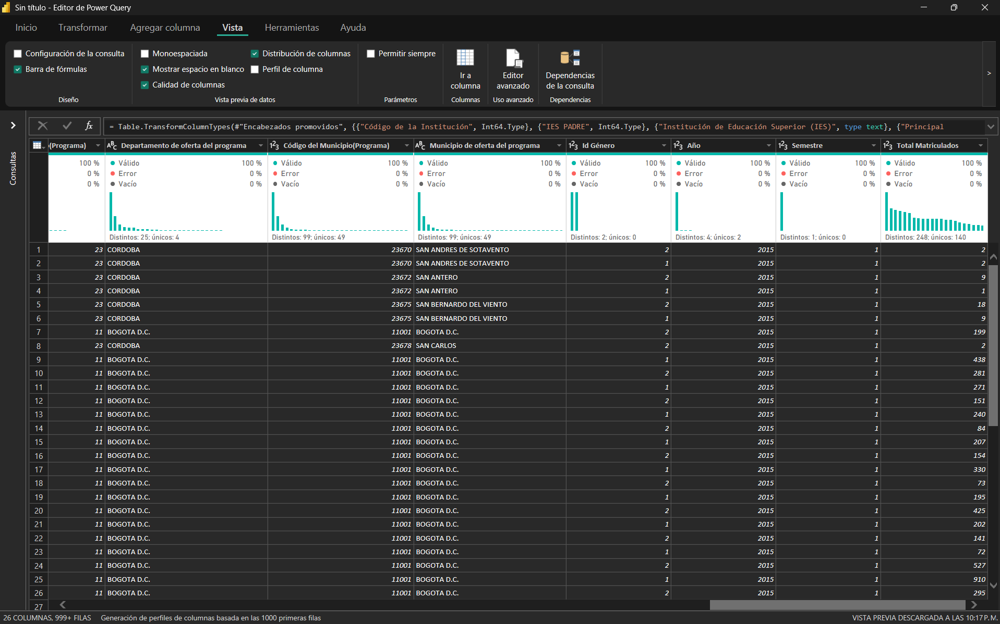
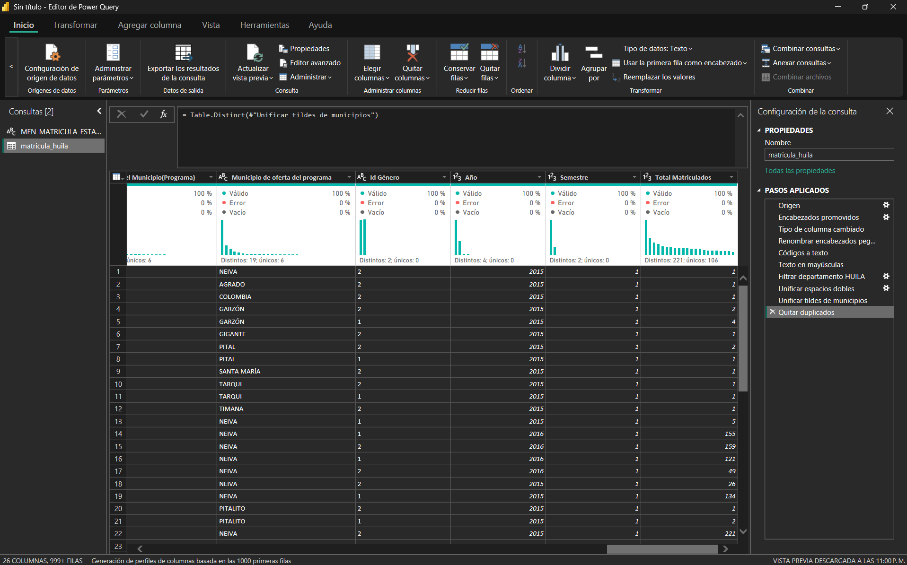
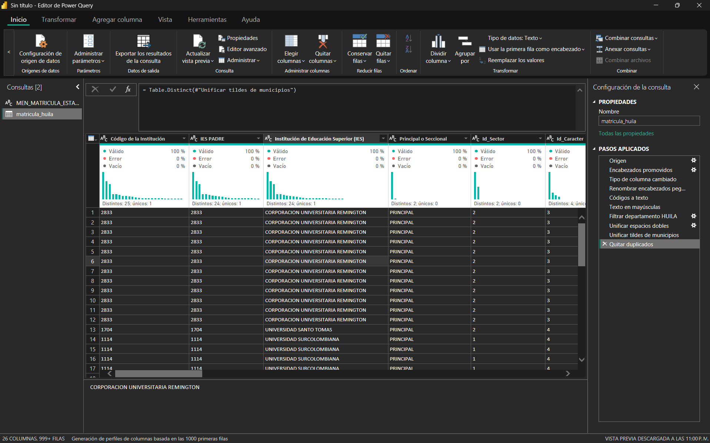

# Inteligencia de Negocios · Semana 8

**Limpia un dataset real con Power Query**
Juan José Horta Vanegas · Ingeniería de Sistemas · Unidad 2 · Corte 2 · 2026-B

---

## El dataset

**MEN_MATRICULA_ESTADISTICA_ES**, publicado por el Ministerio de Educación Nacional en el portal de Datos Abiertos de Colombia. Registra la matrícula en educación superior por institución, programa, municipio de oferta, género y periodo.

- Página: https://www.datos.gov.co/Educaci-n/MEN_MATRICULA_ESTADISTICA_ES/5wck-szir
- Descarga directa (CSV): https://www.datos.gov.co/api/views/5wck-szir/rows.csv?accessType=DOWNLOAD

El archivo pesa 83 MB y tiene **390.903 filas y 26 columnas**. No lo incluyo en el repositorio por su tamaño; el enlace permite descargarlo tal como lo usé.

Lo escogí porque es la fuente real del tipo de análisis que vengo trabajando en el curso: matrícula de educación superior, con cortes por periodo y por municipio. Para esta actividad me quedo con los programas ofertados en el **Huila**.

---

## Diagnóstico de calidad

Revisé el archivo completo y no solo la vista previa. Por defecto Power Query calcula la calidad de columna sobre las primeras 1.000 filas, y en un archivo de casi 400.000 eso deja por fuera la mayor parte de los problemas. En la vista previa todas las columnas aparecían con 100% de valores válidos, sin vacíos ni errores, y el primer problema que encontré fue precisamente que esa impresión era falsa.

### Lo que encontré

**Texto dentro de columnas de códigos.** Las columnas `Id_Area` e `Id_Nucleo` parecen numéricas, pero en 7.910 filas del país (250 del Huila) traen el texto `Sin clasificar` en lugar de un código. La detección automática de tipos de Power Query las declaró número entero porque mira solo las primeras filas, y en las filas con ese texto la conversión falla. En la vista previa no aparecía ningún error; se hizo visible solo al recorrer el archivo completo. Corregí el paso automático de tipos para que esas dos columnas se lean como texto, y conservé `Sin clasificar` como valor: es una categoría con significado, no un dato faltante, y convertirla en vacío sería perder información.

**Encabezados con palabras pegadas.** Tres columnas perdieron espacios en el nombre, probablemente por saltos de línea en el archivo de origen: `Principal oSeccional`, `Municipio dedomicilio de la IES` y `Código SNIES delprograma`.

**Códigos tratados como números.** Power Query leyó como número entero todas las columnas de códigos: institución, programa, departamento, municipio y los identificadores `Id_`. Son identificadores, no cantidades, y sumarlos no significa nada. El síntoma más visible está en los códigos DANE, que ya perdieron el cero a la izquierda: Antioquia aparece como `5` en lugar de `05` y Medellín como `5001` en lugar de `05001`.

**Mayúsculas inconsistentes.** El departamento de oferta aparece escrito de dos formas: `HUILA` en 8.590 filas y `Huila` en 1.999. A nivel nacional la columna tiene 88 valores distintos que en realidad son 54 departamentos. Lo mismo pasa con municipios, instituciones y núcleos del conocimiento.

**Tildes inconsistentes en los municipios.** Un mismo municipio aparece dos veces: `GARZON` y `GARZÓN`, `SAN AGUSTIN` y `SAN AGUSTÍN`, `SANTA MARIA` y `SANTA MARÍA`. Cualquier agrupación por municipio partiría esos totales en dos.

**Espacios dobles dentro del texto.** En el Huila, 327 nombres de programa tienen dos espacios seguidos, por ejemplo `LICENCIATURA EN EDUCACION  FISICA RECREACION Y DEPORTE`. Revisé también los espacios al principio y al final, y no hay ninguno.

**Filas duplicadas.** A nivel nacional hay **106.599 filas exactamente repetidas**: idénticas en las 26 columnas, incluido el total de matriculados. Todas aparecen dos veces, nunca tres, y solo en los años 2015 a 2019. Ese patrón apunta a un error de carga y no a registros legítimos. Por sí solas inflan el total nacional de matriculados de 20,6 a 28,7 millones. En el Huila son 2.776.

### El origen común de casi todo

Al cruzar los problemas apareció la explicación: **el archivo está armado con dos cargas distintas**. Los años 2015 a 2019 vienen en mayúsculas, sin tildes y con los duplicados; 2020 y 2021 vienen con mayúscula inicial, con tildes y sin duplicados. Por eso `Huila` en minúsculas corresponde exactamente a las 1.999 filas de 2020 y 2021.

### Lo que registré pero no transformé

La **metadata no coincide con los datos**: el portal describe el dataset como 2015 y 2016, pero el archivo cubre de 2015 a 2021.

El **cero perdido en los códigos DANE** es real, pero no afecta a mi recorte: el código del Huila es 41 y los de sus municipios tienen cinco cifras completas. Completarlo no resolvería nada en la tabla final.

Hay **14 registros** con la misma combinación de institución, programa, municipio, género y periodo, pero con totales distintos. No son duplicados exactos y sin la fuente original no hay forma de saber cuál es el correcto, así que los dejé sin tocar.

Las columnas `Id_` están **codificadas sin etiqueta** (por ejemplo, `Id Género` solo trae 1 y 2). El archivo no incluye el diccionario, y decodificarlas a ciegas sería inventar datos.

Por último, el municipio `COLOMBIA` que aparece dentro del Huila no es un error: es un municipio real del departamento.

---

## La receta

```
Origen
→ Encabezados promovidos
→ Tipo de columna cambiado
→ Renombrar encabezados pegados
→ Códigos a texto
→ Texto en mayúsculas
→ Filtrar departamento HUILA
→ Unificar espacios dobles
→ Unificar tildes de municipios
→ Quitar duplicados
```

Los tres primeros pasos los genera Power Query al conectar el archivo: leerlo, usar la primera fila como encabezado y detectar los tipos. Ese tercer paso automático es el que convierte los códigos en números: lo ajusté para que `Id_Area` e `Id_Nucleo` se lean como texto, porque de lo contrario las filas con `Sin clasificar` quedan en error, y el resto de códigos los corrige la receta más adelante. Las transformaciones propias son siete, de seis tipos distintos.

---

## Qué resolvió cada transformación

### 1 · Renombrar encabezados

Corregí los tres nombres pegados: `Principal o Seccional`, `Municipio de domicilio de la IES` y `Código SNIES del programa`. Parece cosmético, pero esos nombres son los que después aparecen en los filtros y los ejes del tablero, y una columna llamada `Principal oSeccional` en un informe se ve como un error de quien lo hizo.

### 2 · Códigos a texto

Cambié a tipo texto todas las columnas de códigos y los `Id_`, y dejé como número entero solo `Año`, `Semestre` y `Total Matriculados`. Es la misma prueba de medida contra atributo del modelo estrella: si sumar la columna no tiene sentido, no debe comportarse como número. Con los códigos como texto, Power BI deja de ofrecer sumarlos y no los trata como cantidades en ningún cálculo.

### 3 · Texto en mayúsculas

Pasé a mayúsculas todas las columnas descriptivas de texto. Con eso `Huila` y `HUILA` se vuelven un solo valor, y lo mismo ocurre con los demás departamentos, municipios e instituciones que venían en dos formatos.

### 4 · Filtrar el departamento

Me quedé solo con las filas donde el departamento de oferta es `HUILA`, que es el alcance del análisis.

**El orden de estos dos últimos pasos es la decisión más importante de la receta.** Si filtro antes de pasar a mayúsculas, el filtro solo encuentra las 8.590 filas escritas como `HUILA` y descarta en silencio las 1.999 escritas como `Huila`. Esas filas son la totalidad de 2020 y 2021: el tablero mostraría que el Huila no tuvo matrícula esos dos años, sin ningún mensaje de error. Normalizando primero, el filtro recupera las 10.589 filas.

### 5 · Unificar espacios dobles y tildes

Son dos pasos de reemplazo de valores, uno para cada problema. En `Programa Académico` y en el núcleo del conocimiento reemplacé los espacios dobles por uno solo. Aquí no servía *Recortar*: esa transformación solo quita espacios al principio y al final, y estos están en medio del texto.

En el municipio de oferta unifiqué las tres parejas a su forma correcta, reemplazando la versión sin tilde por la que la lleva: `GARZÓN`, `SAN AGUSTÍN` y `SANTA MARÍA`. Antes de este paso, Garzón aparecía partido en 208 filas sin tilde y 251 con tilde.

### 6 · Quitar duplicados

Eliminé las filas repetidas en todas sus columnas: 2.776 en el Huila. Lo dejé al final a propósito, después de normalizar el texto, porque dos filas que solo difieren en una mayúscula o un espacio no se detectan como duplicadas. Primero se unifica, después se compara.

Es la transformación con más efecto sobre el análisis. Sin ella, el total de matriculados del Huila en el periodo daría **489.583**; con ella da **350.539**. La diferencia es un 40% de matrícula que nunca existió.

---

## Antes y después

| | Antes | Después |
|---|---|---|
| Filas | 390.903 (todo el país) | 7.813 (Huila) |
| Filas duplicadas en el recorte | 2.776 | 0 |
| Formas de escribir el departamento | `HUILA` y `Huila` | `HUILA` |
| Municipios partidos por tildes | 3 | 0 |
| Programas con espacios dobles | 327 | 0 |
| Filas con error de tipo en `Id_Area` / `Id_Nucleo` | 250 | 0 |
| Encabezados pegados | 3 | 0 |
| Códigos como número | sí | no, como texto |
| Total de matriculados del Huila | 489.583 | 350.539 |

**Antes**, al conectar el archivo:





**Después**, con la receta aplicada:



En las filas de 2015 ya aparecen `GARZÓN` y `SANTA MARÍA` con tilde. En el archivo original esos años venían sin ella, así que la captura muestra directamente el efecto del paso de unificación. Todos los municipios corresponden al Huila.



Toda la limpieza quedó registrada como pasos de Power Query. Si el Ministerio publica una versión actualizada del archivo, basta con reemplazarlo y pulsar Actualizar para que las siete transformaciones se vuelvan a aplicar en el mismo orden.
