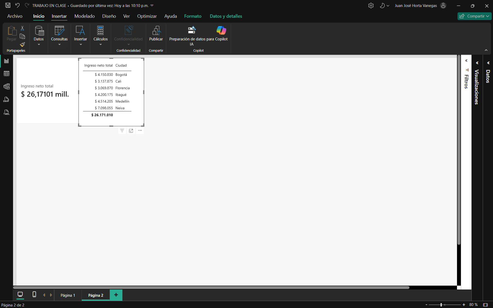

# Inteligencia de Negocios · Semana 9

**Crea tus primeras medidas DAX**
Juan José Horta Vanegas · Ingeniería de Sistemas · Unidad 3 · Corte 2 · 2026-B

Trabajé sobre el modelo de ventas del taller de Power BI: 480 transacciones entre enero y agosto de 2026, con sus datos de ciudad, canal, categoría, entregas y tipo de cliente.

---

## 1. Las medidas

### Total · SUM

```
Ingreso neto total = SUM(Datos[Ingreso_Neto])
```

```
Margen bruto total = SUM(Datos[Margen_Bruto])
```

Son las dos cifras que resumen el negocio. Ambas columnas son plenamente aditivas: sumarlas por ciudad, por mes o por categoría siempre da un resultado interpretable.

### Promedio · AVERAGE

```
Satisfacción promedio = AVERAGE(Datos[Satisfaccion_1_5])
```

Devuelve 4,25 sobre 5. Tiene que ser una medida y no un dato guardado porque los promedios no son aditivos: el promedio de los promedios de cada ciudad no da el promedio real del negocio. Calculado al vuelo sobre las filas que el contexto deje visibles, siempre sale bien.

```
Tiempo promedio de entrega = CALCULATE(AVERAGE(Datos[Tiempo_Entrega_Min]), Datos[Estado_Entrega] <> "No aplica")
```

Aquí el promedio va envuelto en `CALCULATE` para excluir las ventas sin entrega asociada, que tienen cero minutos registrados. Si no se excluyeran, esos ceros arrastrarían el promedio hacia abajo y el indicador mentiría.

### Conteo · COUNTROWS

```
Número de ventas = COUNTROWS(Datos)
```

Cuenta filas de la tabla de hechos. Como el grano es una venta por fila, ese conteo es directamente el número de transacciones: 480.

### Derivada · DIVIDE

```
% entregas tardías = DIVIDE(CALCULATE(COUNTROWS(Datos), Datos[Estado_Entrega] = "Tardía"), CALCULATE(COUNTROWS(Datos), Datos[Estado_Entrega] <> "No aplica"))
```

Divide las entregas tardías entre el total de entregas realizadas, y da 25,2%. Usé `DIVIDE` y no el operador `/` por una razón práctica: el tablero tiene segmentadores, y en cuanto alguien elige una combinación sin entregas —una ciudad en un mes sin despachos, por ejemplo— el denominador se vuelve cero. Con `/` el visual se rompería con un error; con `DIVIDE` simplemente queda en blanco y el resto del tablero sigue funcionando.

---

## 2. Evidencia del cambio por contexto

Puse la misma medida `Ingreso neto total` en dos visuales distintos, sin modificar una sola línea de la fórmula.



En la **tarjeta** devuelve **$26.171.010**, el ingreso de las 480 ventas.

En la **tabla por ciudad** la misma medida se desglosa, y la fila de total muestra $26.171.010: exactamente el valor de la tarjeta. No hay dos medidas, hay una sola evaluándose siete veces, una por cada ciudad y otra para el total general.

De paso, el desglose revela algo que la tarjeta no deja ver: Neiva concentra $7.098.055, muy por encima de las demás ciudades, mientras Florencia apenas llega a $3.069.870. Esa es justamente la utilidad de cambiar el contexto, porque el total general oculta la distribución.

---

## 3. Qué es el contexto de filtro

Una medida en DAX no guarda un número: guarda una instrucción. El valor que muestra depende de **qué filas puede ver en el momento en que se evalúa**, y eso lo determina lo que esté filtrando alrededor.

En la tarjeta no hay nada que la limite, así que `SUM(Datos[Ingreso_Neto])` recorre las 480 filas y devuelve el total. En la tabla, cada fila del visual impone su propio filtro: cuando le toca la fila de Neiva, la medida solo ve las ventas de Neiva y suma esas. Misma fórmula, distinto conjunto de filas visibles, distinto resultado.

Lo comprobé sin querer mientras armaba el tablero. En un momento hice clic sobre un punto del gráfico de línea mensual y los cuatro indicadores cambiaron de golpe: el ingreso pasó de 26,17 millones a 115.005 y el número de ventas de 480 a 1. Más adelante me pasó algo parecido al dejar marcada la ciudad de Cali en un segmentador: el ingreso bajó a 3,13 millones y las ventas a 69.

En ninguno de los dos casos toqué las medidas. Lo único que cambió fue el contexto, y las fórmulas se recalcularon solas. Por eso en Power BI la pregunta "¿por qué este número no coincide?" casi siempre se responde revisando qué está filtrado, no revisando la fórmula.

Visto al revés, ahí está la ventaja: escribo `Ingreso neto total` una vez y me sirve para el total del año, para una ciudad, para un mes o para una categoría, sin escribir una medida distinta para cada corte.

---

## 4. ¿Alguna debería ser columna calculada?

Ninguna. Las seis son agregaciones y tienen que recalcularse según el contexto, que es exactamente lo que una columna calculada no puede hacer: se evalúa una sola vez al cargar los datos y queda fija.

El caso más claro es `% entregas tardías`. Si lo hiciera como columna, tendría que escribir algo por fila, y ahí el cálculo pierde sentido: una venta individual está tarde o no lo está, no tiene un porcentaje. Y si guardara una columna con 1 para las tardías, Power BI la sumaría al agregarla y el total mostraría el número de entregas tardías, no su proporción. El porcentaje solo existe cuando se calcula sobre un conjunto, y qué conjunto es eso lo decide el filtro.

Con `Satisfacción promedio` pasa lo mismo por la vía de los promedios no aditivos: una columna guardaría el promedio calculado en el momento de la carga y al agruparla por ciudad daría cifras incorrectas, porque sumaría o promediaría valores ya promediados.

Donde sí tendría sentido una columna calculada en este modelo sería para **clasificar**, no para agregar: por ejemplo, una columna que marque cada venta como "con descuento" o "sin descuento" según el valor de `Descuento_Pct`, para poder usarla como filtro o como eje de un gráfico. Ese es un valor fila por fila, estable, que no depende del contexto. Aun así, lo correcto sería crearla en Power Query y no en DAX, porque la lógica de preparación pertenece al ETL y así el modelo queda más liviano.
