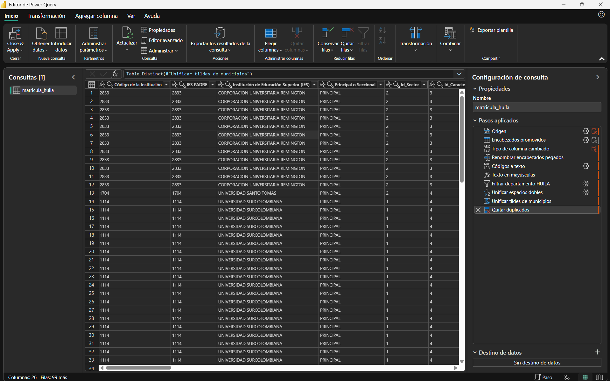
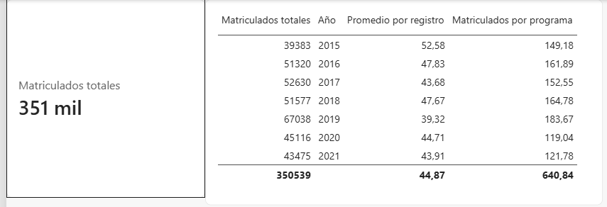

# Mini-ETL y primeras medidas · Corte 2

Juan José Horta Vanegas · Inteligencia de Negocios · Ingeniería de Sistemas · 2026-B

---

## De dónde salen los datos

El dataset es la matrícula estadística de educación superior del Ministerio de Educación Nacional, publicada en el portal de Datos Abiertos de Colombia. Es el mismo archivo que trabajé en la semana 8, y lo retomé porque es el mejor ejemplo que encontré de un archivo público realmente sucio.

- Página: https://www.datos.gov.co/Educaci-n/MEN_MATRICULA_ESTADISTICA_ES/5wck-szir
- Descarga directa (CSV): https://www.datos.gov.co/api/views/5wck-szir/rows.csv?accessType=DOWNLOAD

El archivo trae 390.903 filas y 26 columnas, y pesa 83 MB, así que no lo subo al repositorio. Lo conecté a Power Query leyendo el CSV directamente (delimitador coma, codificación UTF-8) y dejé la consulta con el nombre `matricula_huila`.

---

## Pasos aplicados



La receta completa, en el orden en que se ejecuta:

1. **Origen**: lee el CSV.
2. **Encabezados promovidos**: la primera fila pasa a ser el encabezado.
3. **Tipo de columna cambiado**: detección automática de tipos, que ajusté a mano.
4. **Renombrar encabezados pegados**
5. **Códigos a texto**
6. **Texto en mayúsculas**
7. **Filtrar departamento HUILA**
8. **Unificar espacios dobles**
9. **Unificar tildes de municipios**
10. **Quitar duplicados**

Los tres primeros los genera Power Query al conectar. Los otros siete son las transformaciones propias, y cada una responde a un problema que encontré revisando el archivo completo y no solo la vista previa de las primeras mil filas.

### Qué problema resolvió cada una

**Renombrar encabezados.** Tres columnas habían perdido espacios en el nombre: `Principal oSeccional`, `Municipio dedomicilio de la IES` y `Código SNIES delprograma`. Esos nombres son los que luego aparecen en filtros y ejes, y así se veían como un error de quien arma el informe.

**Códigos a texto.** La detección automática leyó como número entero todas las columnas de códigos, y eso los daña: sumar un código no significa nada, y los códigos DANE pierden el cero inicial, de modo que Antioquia aparece como `5` en vez de `05`. Además, `Id_Nucleo` y `Id_Area` traen el texto `Sin clasificar` en 7.910 y 192 filas respectivamente, que al leerse como número daban error en cuanto Power Query recorría el archivo completo. Por eso ajusté también el paso de tipos automático para que esas dos se lean como texto.

**Texto en mayúsculas.** El departamento aparecía como `HUILA` en 8.590 filas y como `Huila` en 1.999, porque el archivo está armado con dos cargas distintas: la de 2015 a 2019 en mayúsculas y la de 2020 y 2021 con mayúscula inicial. Para la máquina son valores diferentes, y cualquier agrupación quedaría partida en dos.

**Filtrar el departamento.** El archivo cubre todo el país y el análisis es del Huila. El orden con el paso anterior es la decisión importante: si filtro antes de pasar a mayúsculas, descarto en silencio las 1.999 filas de 2020 y 2021, y el departamento aparecería sin matrícula esos dos años sin ningún aviso. Normalizando primero, el filtro conserva las 10.589 filas.

**Unificar espacios y tildes.** Son dos pasos de reemplazo. Los nombres de programa traían espacios dobles dentro del texto, donde *Recortar* no sirve porque solo quita los de los extremos. Y tres municipios aparecían escritos de dos formas, con y sin tilde (`GARZON` y `GARZÓN`, `SAN AGUSTIN` y `SAN AGUSTÍN`, `SANTA MARIA` y `SANTA MARÍA`), lo que partía sus totales.

**Quitar duplicados.** Hay filas repetidas exactamente dos veces, idénticas en las 26 columnas y solo en los años de 2015 a 2019, lo que apunta a un error de carga. En el Huila son 2.776, y sin quitarlas el total de matriculados sería 489.583 en vez de 350.539. Va al final a propósito: dos filas que solo difieren en una mayúscula o un espacio no se detectan como duplicadas, así que primero se unifica el texto y después se compara.

La tabla pasó de 10.589 a **7.813 filas**, que es la que cargué al modelo.

---

## Las tres medidas

```
Matriculados totales = SUM(matricula_huila[Total Matriculados])
```

```
Promedio por registro = AVERAGE(matricula_huila[Total Matriculados])
```

```
Matriculados por programa = DIVIDE([Matriculados totales], DISTINCTCOUNT(matricula_huila[Código SNIES del programa]))
```

La primera suma la matrícula y da 350.539. La segunda promedia la matrícula de cada registro (una combinación de programa, municipio, género y periodo) y da 44,87. La tercera es la derivada: divide la matrícula total entre la cantidad de programas distintos que hay en ese momento y da 640,84. Usé `DIVIDE` y no el operador `/` porque en cuanto un filtro deje sin programas el contexto, el denominador será cero, y con `/` el visual mostraría un error mientras que `DIVIDE` lo deja en blanco.

---

## Cómo cambia una medida al filtrar por una dimensión



Puse `Matriculados totales` en una tarjeta y después en una tabla por año. Como el modelo es una sola tabla, la dimensión es la columna `Año`. La tarjeta muestra "351 mil" porque Power BI redondea el valor, pero es el mismo 350.539 que aparece en la fila de total de la tabla (350539).

El **contexto de filtro** es el conjunto de filas que una medida puede ver en el momento de calcularse. En la tarjeta no hay nada que lo restrinja, así que la medida suma las 7.813 filas. En la tabla, cada fila impone su propio filtro: cuando le toca 2019, la medida solo ve las filas de 2019 y devuelve 67.038, y cuando le toca 2020 devuelve 45.116. La fórmula es la misma en todos los casos; lo que cambia es qué filas tiene delante.

La medida derivada lo muestra todavía mejor, porque el filtro afecta al numerador y al denominador a la vez. En 2019 divide 67.038 entre 365 programas distintos y da 183,67; en 2020 divide 45.116 entre 379 y da 119,04. Y en la fila de total, el promedio (44,87) y el cociente (640,84) no son la suma de las filas de arriba, sino el cálculo sobre todas las filas juntas, que es justamente lo que una medida hace y una columna calculada no.

---

## ETL steps & measures

The source is a public CSV file from Colombia's Ministry of Education with 390,903 rows and 26 columns, which I connected to Power Query and cleaned in seven steps. First, I renamed three column headers that had lost their spaces, and I converted every code column to text, because codes are identifiers and should never be summed. Second, I converted all descriptive text to uppercase, since the same department appeared as "HUILA" in some years and "Huila" in others, and I did this before filtering so that no rows were silently lost. Third, I filtered the data to the Huila department, replaced double spaces inside program names, and fixed three municipalities that appeared both with and without accents. Finally, I removed the exact duplicate rows, which reduced the table from 10,589 to 7,813 rows and the total number of enrolled students from 489,583 to 350,539. After loading the table into the model, I created three DAX measures: "Matriculados totales" uses SUM to add up the enrolled students, "Promedio por registro" uses AVERAGE to get the mean per record, and "Matriculados por programa" uses DIVIDE to split the total by the number of distinct programs. I used DIVIDE instead of the division operator so that the measure returns a blank instead of an error when a filter leaves no programs in the context.
