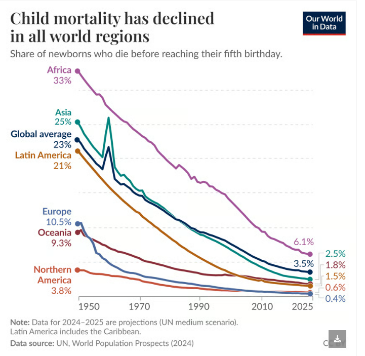
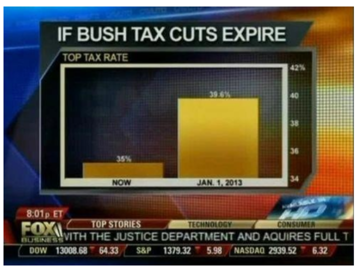
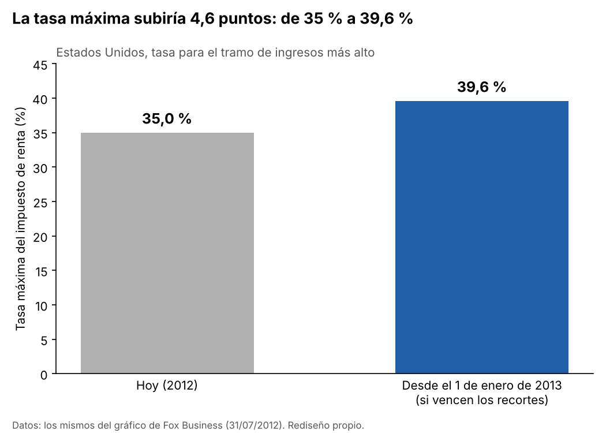

# Semana 11 · Crítica visual: lo bueno y lo malo

**Estudiante:** Juan José Horta Vanegas
**Asignatura:** Inteligencia de Negocios · Corte 3 · 2026-B

---

## 1. El gráfico bueno: la mortalidad infantil en el mundo

**Fuente:** Max Roser, *Child mortality has declined in all world regions*, Our World in Data, 6 de octubre de 2026. https://ourworldindata.org/data-insights/child-mortality-has-declined-in-all-world-regions
Datos: Naciones Unidas, *World Population Prospects* (2024); 2024 y 2025 son proyecciones.

**¿Qué pregunta responde?** Cómo ha cambiado, desde 1950, la proporción de niños que mueren antes de cumplir cinco años en cada región del mundo.

**¿Es el gráfico adecuado?** Sí. Es una pregunta de evolución en el tiempo y por eso usa líneas, que es lo que corresponde a ese tipo de pregunta. Además, poner una línea por región en el mismo gráfico permite comparar las regiones sin tener que saltar entre varias figuras: se ve de una vez que África sigue arriba y Norteamérica abajo, pero que todas bajan.

**¿Respeta las buenas prácticas?**

- *Título-conclusión:* es lo mejor del gráfico. No se titula "Mortalidad infantil por región", sino *Child mortality has declined in all world regions* ("La mortalidad infantil ha bajado en todas las regiones del mundo"). Quien solo lee el título ya se lleva la idea principal, y el subtítulo aclara qué se mide: la proporción de recién nacidos que mueren antes de cumplir cinco años.
- *Eje:* la escala parte de cero; por eso Europa, con 0,4 % en 2025, queda casi pegada a la base. En vez de llenar el eje vertical de números, escribe el valor al inicio y al final de cada línea (África pasa de 33 % a 6,1 %; el promedio mundial, de 23 % a 3,5 %), que es justo lo que el lector quiere comparar.
- *Poca tinta:* no tiene leyenda aparte: cada región está escrita junto a su línea y con el mismo color, así que no hay que ir y volver a una caja de colores. Las líneas guía son punteadas y muy suaves, no hay marco, fondo ni efectos 3D. El color sí tiene propósito: distinguir regiones, y el promedio mundial va en azul oscuro para que sirva de referencia.
- *Honestidad con los datos:* marca 2024 y 2025 como proyecciones y no los mezcla con los datos observados. El texto que lo acompaña tampoco esconde lo que no encaja en la tendencia, como el pico de Asia hacia 1960, que atribuye a la hambruna del "Gran Salto Adelante" en China.
- *Fuente visible:* dice de dónde salen los datos y con qué licencia.

**Lo que mejoraría:** muy poco. El título dice que la mortalidad bajó, pero no cuánto. Agregar la magnitud (por ejemplo, que en Europa cayó unas 27 veces y en África unas 5 veces, cifras que el artículo sí da) lo haría todavía más fuerte.

---

## 2. El gráfico malo: la tasa máxima de impuestos en Fox

**Fuente:** gráfico emitido en *Cavuto*, de Fox Business, el 31 de julio de 2012. Documentado en:
- Media Matters, *A history of dishonest Fox charts*: https://www.mediamatters.org/fox-friends/history-dishonest-fox-charts
- Nathan Yau, *Fox News continues charting excellence*, FlowingData, 6 de agosto de 2012: https://flowingdata.com/2012/08/06/fox-news-continues-charting-excellence/

**¿Qué pregunta responde?** Cuánto subiría la tasa máxima del impuesto de renta en Estados Unidos si vencían los recortes de impuestos de Bush: del 35 % vigente al 39,6 % desde el 1 de enero de 2013.

**¿Es el gráfico adecuado?** El tipo sí: comparar dos valores con barras es correcto. El problema es cómo se construyó.

**¿Respeta las buenas prácticas?** No, y la falla es grave:

- *Eje en cero:* el eje vertical, que además está a la derecha y con números muy pequeños, arranca en 34 % y llega a 42 %, no parte de 0 %. En un gráfico de barras lo que el ojo compara es el largo de cada barra, así que cortar el eje cambia el mensaje. Con la base en 34, la barra de 35 % mide 1 punto y la de 39,6 % mide 5,6 puntos: la segunda se ve más de cinco veces más alta, cuando en realidad 39,6 es apenas un 13 % mayor que 35 (39,6 ÷ 35 ≈ 1,13). Un aumento de 4,6 puntos porcentuales termina pareciendo una explosión.
- *Orden:* las barras van en orden cronológico ("NOW" y "JAN. 1, 2013"), que es el orden natural para este caso. Ahí no hay problema.
- *Título-conclusión:* el título, "IF BUSH TAX CUTS EXPIRE" ("Si vencen los recortes de impuestos de Bush"), plantea la situación pero no dice qué pasa. La conclusión se la deja al tamaño de las barras, que es justamente la parte engañosa. Un título honesto diría cuánto sube la tasa.
- *Poca tinta:* el gráfico compite con todo lo que tiene alrededor: un fondo de rayos azules y naranjas, un marco doble, el logo del canal y la franja con la bolsa de valores. Los valores (35 % y 39,6 %) van en letra muy pequeña sobre las barras, mientras lo que más se ve es la diferencia de altura exagerada.

---

## 3. Rediseño del gráfico malo

Usé exactamente los mismos dos datos (35 % y 39,6 %) y cambié cuatro cosas:

1. **El eje empieza en 0 %.** Así el largo de las barras es proporcional al valor y la diferencia se ve del tamaño que realmente tiene.
2. **El título dice la conclusión:** "La tasa máxima subiría 4,6 puntos: de 35 % a 39,6 %". El lector no tiene que adivinar el tamaño del cambio.
3. **El valor va escrito sobre cada barra**, para que nadie tenga que estimarlo mirando el eje.
4. **Un solo color con propósito:** la barra actual en gris y la nueva tasa en azul, que es la que interesa. Dejé solo lo necesario: sin fondo, sin marco y sin efectos.

Con estos cambios el gráfico sigue mostrando que la tasa sube, pero ya no hace parecer el aumento cinco veces más grande de lo que es.
