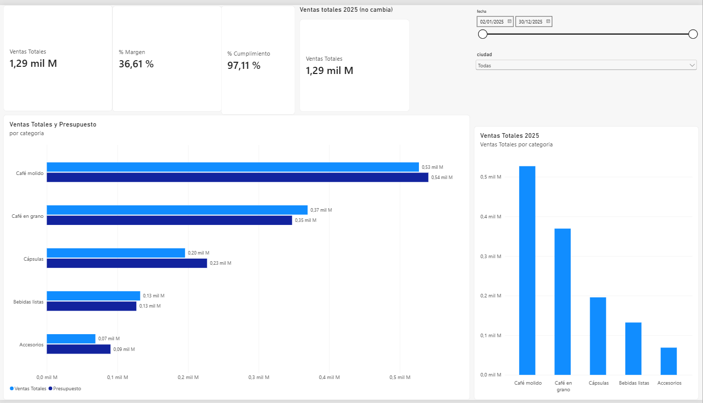
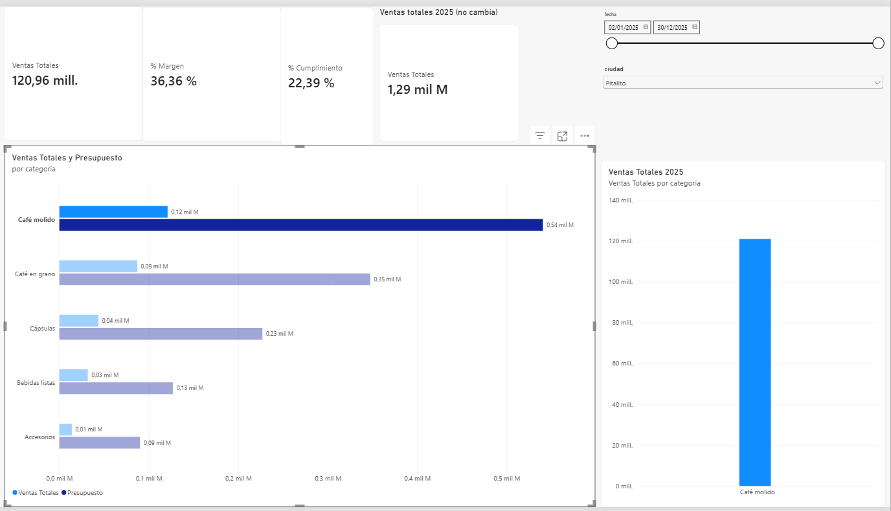

# Semana 12 · Haga interactivo su dashboard

**Estudiante:** Juan José Horta Vanegas
**Asignatura:** Inteligencia de Negocios · Corte 3 · 2026-B
**Archivo:** `Horta-Juan-semana12.pbix` (dashboard de la tostadora de café, parcial del Corte 2)

---

## 1. Segmentadores

| Segmentador | Campo | Estilo |
|---|---|---|
| Fecha | Ventas[fecha] | Entre (rango, 02/01/2025 – 30/12/2025) |
| Ciudad | Dim_Cliente[ciudad] | Desplegable |

## 2. Interacciones

Origen del clic: la barra de **Café molido** en el gráfico de ventas y presupuesto por categoría, con Pitalito elegido en el segmentador de ciudad.

| Visual | Por defecto | Final (Editar interacciones) |
|---|---|---|
| Tarjeta Ventas Totales | Filtrar: la cifra bajó de 297,29 a 120,96 mill. | Filtrar (sin cambios) |
| Tarjeta % Margen | Filtrar: se recalculó con la selección (de 36,61 % sin filtro a 36,36 %) | Filtrar (sin cambios) |
| Tarjeta % Cumplimiento | Filtrar: cambió de 22,33 % a 22,39 % | Filtrar (sin cambios) |
| Gráfico de columnas por categoría y producto | [COMPLETAR] | **Filtrar** (cambiado desde Resaltar): quedó solo la columna de Café molido |
| Tarjeta «Ventas totales 2025 (no cambia)» | Filtrar, igual que las otras tarjetas | **Ninguno**: se quedó en 1,29 mil M |

La tarjeta que no cambia también está en Ninguno respecto a los dos segmentadores y al gráfico de columnas, para que siempre muestre el total del año.

## 3. Panel de filtros

Filtro de **todas las páginas** sobre Ventas[fecha]: del 01/01/2025 al 31/12/2025, con el candado cerrado para que el usuario no lo pueda cambiar. Como todas las ventas son de 2025, no altera ninguna cifra.

## 4. Drill-down

Jerarquía **Categoría → Producto** (Dim_Producto) en el gráfico de columnas. Con la flecha de exploración activada y un clic en Café molido, el gráfico pasa de las 5 categorías a los 5 productos de esa categoría: Molido Hotelero 2,5 kg, Molido Premium 500 g, Molido Orgánico 340 g, Molido Tradicional 500 g y Molido Tradicional 250 g. La tarjeta de Ventas Totales marcó 526,96 millones en ese nivel, igual que la suma de los cinco. La flecha hacia arriba devolvió el gráfico a las categorías y las tarjetas a su valor total.

## 5. Prueba del clic: cifras de control

| Estado | Cifra esperada | Cifra que muestra el tablero |
|---|---|---|
| Sin filtro | $ 1.293.013.295 | 1,29 mil M |
| Ciudad Pitalito | $ 297.291.735 | 297,29 millones |
| Categoría Café molido | $ 526.959.950 | 526,96 millones |

La tarjeta muestra la cifra abreviada, por eso aparece como «1,29 mil M», «297,29 mill.» y «526,96 mill.». Con Pitalito y Café molido a la vez la tarjeta marcó 120,96 millones, igual que los $ 120.964.850 esperados.

## 6. Capturas y comentario

**Sin filtro**

**Filtrado**

Sin filtro, el tablero muestra el año completo: 1,29 mil millones en ventas, 36,61 % de margen y 97,11 % de cumplimiento, con Café molido como la categoría que más vende. Responde a la pregunta de cómo le fue a la tostadora en 2025 frente al presupuesto. Con Pitalito y Café molido elegidos, las ventas bajan a 120,96 millones: es el 40,7 % de lo que vende Pitalito (297,29 millones) y el 9,4 % del total del año, así que ese estado contesta cuánto aporta una categoría en una ciudad concreta. El % de cumplimiento baja a 22,39 % porque se compara con el presupuesto de toda la categoría, que no está repartido por ciudad, y por eso no es una medida confiable en ese estado. La tarjeta de ventas totales de 2025 no se movió y sirve de referencia para ver cuánto pesa la selección.
