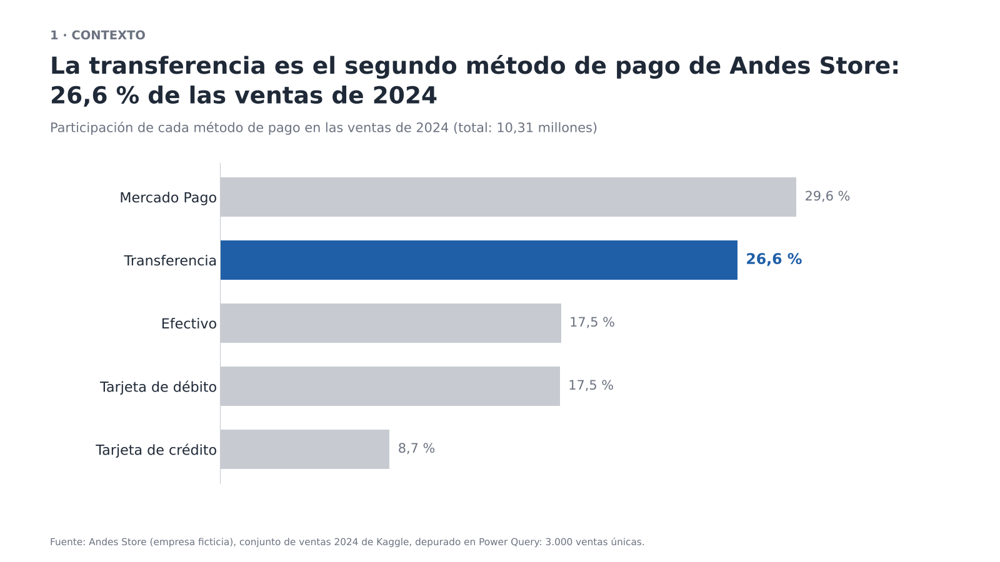
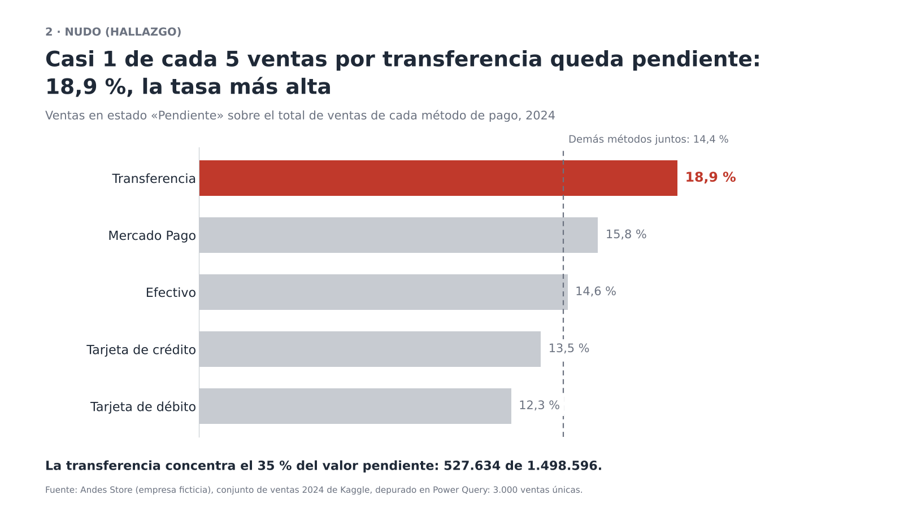
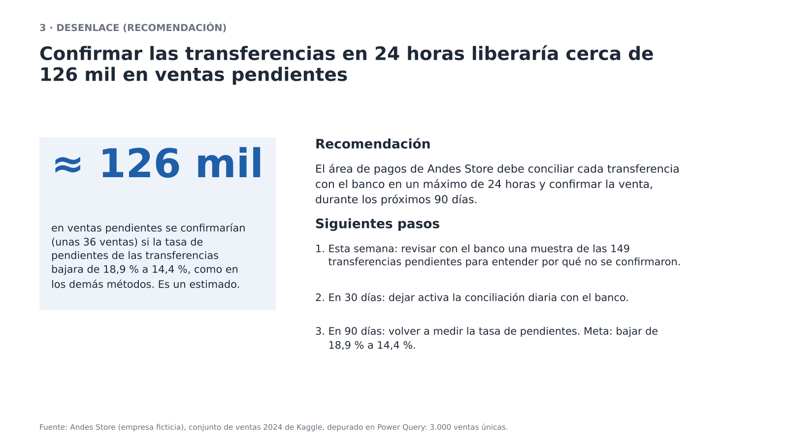

# Semana 13 · Cuenta la historia de tus datos

**Estudiante:** Juan José Horta Vanegas
**Hallazgo del proyecto:** las ventas pagadas por transferencia quedan en estado «Pendiente» más seguido que las de cualquier otro método de pago.
**Datos:** Andes Store (empresa ficticia), ventas 2024 del conjunto de Kaggle del proyecto de aula, depurado en Power Query (3.000 ventas únicas, total 10.310.319; el conjunto no indica la moneda).

## Las tres láminas

| Lámina | Título-conclusión | Dato resaltado |
|---|---|---|
| 1. Contexto | La transferencia es el segundo método de pago de Andes Store: 26,6 % de las ventas de 2024 | Barra azul de Transferencia: 26,6 % |
| 2. Nudo | Casi 1 de cada 5 ventas por transferencia queda pendiente: 18,9 %, la tasa más alta | Barra roja de Transferencia: 18,9 % (los demás métodos: 14,4 %) |
| 3. Desenlace | Confirmar las transferencias en 24 horas liberaría cerca de 126 mil en ventas pendientes | Cifra azul «≈ 126 mil» |

## Recomendación y siguientes pasos

El área de pagos de Andes Store debe conciliar cada transferencia con el banco en un máximo de 24 horas y confirmar la venta, durante los próximos 90 días.

1. Esta semana: revisar con el banco una muestra de las 149 transferencias pendientes para entender por qué no se confirmaron.
2. En 30 días: dejar activa la conciliación diaria con el banco.
3. En 90 días: volver a medir la tasa de pendientes. Meta: bajar de 18,9 % a 14,4 %.

## Por qué esta historia llevaría a una decisión

La historia pasa de un método que pesa mucho (26,6 % de las ventas) a un problema concreto: casi una de cada cinco de esas ventas no se confirma, y la diferencia frente a los demás métodos no parece casualidad (prueba chi-cuadrado, p = 0,0026). Además, la transferencia concentra el 35 % del valor pendiente de toda la empresa, así que un solo cambio de proceso ataca la parte más grande del problema. La recomendación tiene responsable, plazo y una meta medible, por lo que quien decide puede aprobarla o rechazarla de inmediato. El impacto de 126 mil es un estimado: supone que la transferencia lograría la tasa de los demás métodos, con el ticket promedio de las ventas pendientes por transferencia (≈ 3.541).
